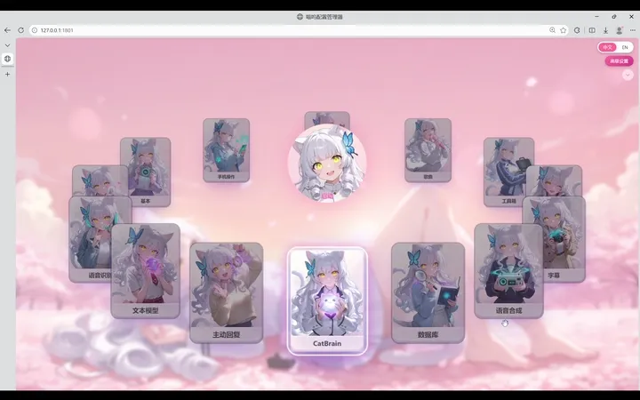

# Meowlisis!

[](README.md) [](README.en.md)

[](LICENSE)

> 本项目采用 [MIT 许可证](LICENSE) 开源。

<p align="center"></p>

```
写代码的初衷是希望自己做动画的时候有个人陪我聊天
然后找不到人，就把一只小猫变成人了awa
更新频率随缘，可以在B站@YGZ醒脑片的直播间不定期看到
```

## 写在最前面
- 这里是Github的源代码区。
- 整合包地址：【百度网盘】链接: https://pan.baidu.com/s/1Ea-LSXFDMSUIN0o-9n4OBQ?pwd=0204 提取码: 0204 
--来自百度网盘超级会员v2的分享
- 超级感谢一下项目的开源，进行了些许参考：
- 整体框架逻辑给我了些许启发：[@worm128/AI-YinMei](https://github.com/worm128/AI-YinMei)
- TTS的音色优化：[@High-Logic/Genie-TTS](https://github.com/High-Logic/Genie-TTS)
- 最喜欢的猫娘项目，在记忆模块方面让我学到了很多：[@Project-N-E-K-O/N.E.K.O](https://github.com/Project-N-E-K-O/N.E.K.O)
- 针对TTS的合成加速，从这个项目第一次了解到GPU Graph的加速方法：[@chinokikiss/GSV-TTS-Lite](https://github.com/chinokikiss/GSV-TTS-Lite)
- WDA：完成了苹果手机的 XCTest 连接使用，伟大无需多言：[@appium/WebDriverAgent](https://github.com/appium/WebDriverAgent)

## 功能说明

<p align="center"><a href="工作流程解析/【待完善】meowlisis工作流程.webp"></a></p>

*⚠️ 核心功能流程图（待完善，点击图片查看大图）*

完整的功能、模块、配置与运行说明见 [项目各个模块详细说明](INSTRUCTION.md)。

- 运行环境：Windows 10/11，Python 3.11（项目内置 runtime），依赖见 requirements.txt
- 快速开始：见 INSTRUCTION 的「运行环境」

## 一些原创算法
```也可能不是原创，反正是自己瞎想瞎做的，有兴趣的可以看一下```
### 一、LLM水词的优化

```
对应模块：
func/llm/narration/
```

思路：LLM 回复"水"（全是套话废话）时自动压缩，回复内容丰富时完整保留语气词，让语音合成听起来不啰嗦、不干瘪。核心是「打分 → 分档 → 流式清洗」三层结构：

1. **水词库 → Trie 前缀树**：`adjunct_word.json` 可删除词（参与打分+删除）、`score_only_word.json` 只打分词（人设语气），构建 Trie，最长匹配优先，O(词长)。
2. **EWMA 平滑打分**（每轮用清洗前源文本）：
   - `Raw = max(0, density − penalty)`
   - `density = 100 − (W/L)×100`，当 `W/L ≥ density_threshold` 时 `density = 0`（W=水词总长度，L=文本长度）
   - `penalty = min(length_penalty_cap, max(0, L − length_threshold) × length_penalty_rate)`
   - `S = λ·S_prev + (1−λ)·Raw`，`λ = λ_down (Raw<S) / λ_up (Raw>S) / λ_equal (Raw=S)`
3. **三档流式清洗**（由 S 定档）：
   - `S ≥ part_level_upper` → 不删（FULL）
   - `part_level_lower ≤ S < part_level_upper` → 仅删类别 ∈ {2,3,5}（PART）
   - `S < part_level_lower` → 删全部可删词（ALL）
   - 逐字符 `feed`：Trie 最长匹配，可删词按档位丢弃，命中前缀则暂存；`flush()` 收尾。
4. **标点整理**：清洗后合并连续标点为句号、去掉句首残留标点、纯标点句不发送；再按标点切分为小句流式送入 TTS，保证断句自然。

相关配置：`config.yml → llm.narration`。

### 二、哼唱歌曲接龙触发

```
对应模块：
func/toolbox/meowsongs/hum_detect/hum_detect.py
func/toolbox/meowsongs/pass_the_baton
func/pipeline/toolbox_audio.py
```

思路：用户在角色唱歌时跟着哼一段，角色识别出是哪首歌、哼到哪了，然后**接着往下唱几句**（传花接龙），并播报感想、写入记忆。

1. **哼唱检测**：逐帧 RMS 能量，`rms ≥ vad_energy_threshold`（SenseVoice 配置）视为有声并累积，静音 `≥ silence_threshold` 判定段结束；累积 `≥ hum_collect_sec(7s)` 立即判定。pyin 提 F0（65–800Hz）→ MIDI 音高，只统计有声帧，判据：
   - 有声帧占比：`|voiced|/|f0| ≥ f0_voiced_ratio`
   - 稳定帧占比：`mean(|Δmidi| < f0_stable_half_step) ≥ f0_stable_ratio`
   - 唯一音符数：`len(unique(round(midi))) ≥ f0_unique_notes`
2. **7 秒定歌（lock）**：yin 提 F0（80–800Hz）得哼唱音高序列，与每首歌 vocal 音高缓存（npy）均去均值 `midi' = midi − mean(midi)`，向量化滑窗余弦 `score = max_i dot(w_i,q)/(‖w_i‖·‖q‖)`；`score ≥ match_threshold` 且与次优分差 `≥ min_margin` 才锁定 `{title, offset = best_idx×HOP/SR}`。
3. **段结束接唱（sing）**：用整段哼唱重跑一次余弦匹配，对齐位置即 offset。LRC 时间轴定位，`user_lyric` = `[offset, offset+hum_duration]` 内歌词；从 `offset+hum_duration` 后第一句起取 `hum_lines` 句；播放 `vocal[start_sec : end_sec]`（end=下一句起始，无则至结尾）。
4. **记忆与感想**：用户哼的歌词与 AI 接唱的歌词写入短期/长期/用户记忆（type=hum_song）；接唱播完后由 toolbox LLM 按模板生成感想（含歌名与接唱歌词）播报；若没锁定或分差不足，带 `[System]` 前缀直接告知 LLM 候选歌曲与"先别接唱"，由角色用自己的话确认是否在唱。

相关配置：`config.yml → meowsongs.pass_the_baton`。

### 三、导演（主动回复的表演规划）

```
对应模块：
func/llm_active/director
func/pipeline/msg_director.py
```

思路：角色空闲后主动开口，不是随机说一句，而是先排一段可以推进的表演计划，再一回合走一步。

1. **规划**：`director_plan` 输出 steps，每步含 goal（这一步要达成什么）、move（具体做什么）、expect（预期用户反应）、if_not（没达到怎么办）。
2. **执行**：导演激活期间用户回合由 `msg_director.py` 接管，复用主链路回复逻辑，每回合只推进或完成一步。
3. **推进与收尾**：`director_step` 打标 done / adjust / advance / clear；漏标累计 `stall_turns` 触发补判；全部完成或用户明确拒绝就收尾。
4. **素材**：规划阶段可查 `character/memory`，也可复用 B 站视频素材池。
5. **落盘与提示词**：状态写 `.temp/director_topic/main.json`，clear 后归档到 `character/director_topic/main/`；`director_block.py` 把当前计划渲染成「当前对话走向」块插进 system_prompt。
6. **QQ 简化版**：`func/toolbox/napcat/director` 有独立的状态、判官与提示词，不参与群聊冒泡。

相关配置：`config.yml → llm_active.director`、`napcat.director_qq`。

## 前端展示

主界面的实际录屏（轨道卡片 / 3D 压感 / 扇形展开 / 看壁纸 / 高级设置）
- 下面是部分展示（720×450 · 12fps · 2.0MB）：

<p align="center"></p>


## To do list
1. 补全施工内容

## 相关文档
- 插件系统：[plugins/plugins.md](plugins/plugins.md)
- CatPaws 服务：[.vendor/.CatPaws/README.md](.vendor/.CatPaws/README.md)
- 手机界面：[.vendor/.cam/README.md](.vendor/.cam/README.md)
