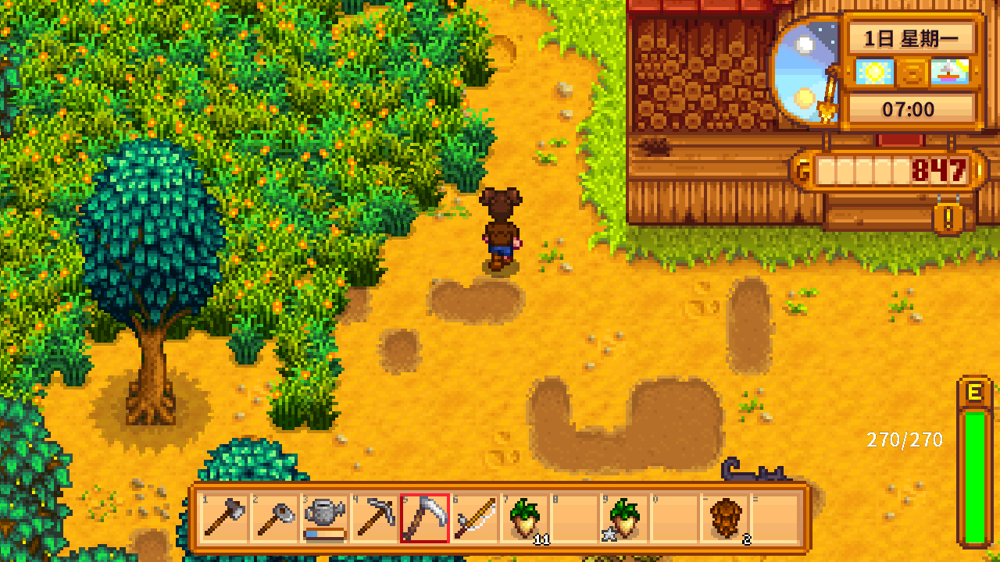
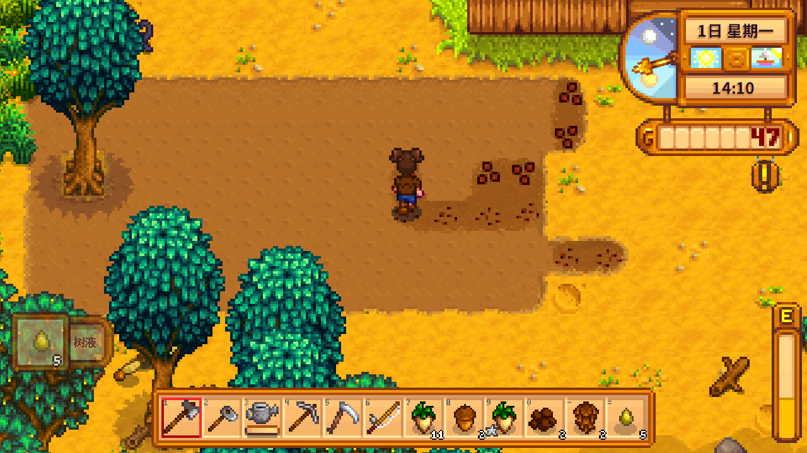
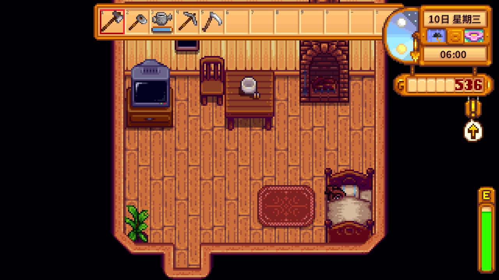

<div align="center">

</div>

<h1 align="center">🌾 星露谷农场小报 🌾</h1>

<p align="center">
  <b>第 0.8.1 期</b> · 2026-11-08 · 主编：Meowlisis · 特约记者：你
</p>

<p align="center">
  
  
  
  
</p>

---

> **头版头条**
>
> ## 她把锄头扛进田里，说“今天要把这片地整完”
>
> 本报讯——星露谷的农夫 Meowlisis 今天没有等指令。她自己读了状态、看了天气、走到田边，开垦、播种、浇水，中间还去镇上接了委托、和人聊了天。本报记者全程围观，没有插手。

---

<table>
<tr>
<td width="62%" valign="top">

### 今日现场

**上午 07:40 · 农场东侧**

她先清掉脚边的杂物，再把锄头一格一格往前推。太阳还没升高，田里已经翻出一大片新土。


<sub>▲ 现场照片：第 1 天 07:40，农场清地。左上角的 HUD 框已经拆掉。</sub>

**下午 14:10 · 新开的田**

这片地是她自己算出来的。没有人告诉她“要开 69 格”，她只是觉得“这块能连成一片”。


<sub>▲ 现场照片：第 1 天 14:10，开垦后的田。</sub>

</td>
<td width="38%" valign="top">

### 今日短讯

**● 读信**

邮箱里躺着 Joja 的医疗账单、Robin 的寻斧启事和花舞节邀请。她一封一封读完，再关掉。

**● 购物**

她走到皮埃尔杂货店的柜台前，买了当季种子。没有走后门，没有凭空变出种子。

**● 出货**

粘土、树液、纤维、防风草——她把能换钱的都送进了出货箱。

**● 社交**

和 Abigail 聊了夏天，和玛妮聊了宠物，给潘妮送了一根防风草。潘妮很喜欢。

**● 矿洞**

第 3 天她自己去了矿洞，从第 1 层下到第 5 层，敲了 74 块石头，打倒 2 只怪。


<sub>▲ 现场照片：矿洞。</sub>

---

## 号外｜她不是按脚本走，是每一步自己选

**本报讯** 旧版本里，角色由一张固定的“目标表”和固定的“步骤表”驱动，看起来像在玩，其实是在执行脚本。

现在不一样了：

- 每一步先读游戏状态：时间、天气、体力、背包、人物、作物、当前界面；
- 模型看着状态，自己决定“下一步用什么工具、参数填什么”；
- 插件只负责执行、记录、写日记；
- 没有固定 goal，没有固定步骤，没有动作白名单。

> **编辑部注**：当日计划只是“今天大概想做什么”的文字打算，不是命令清单。她可以随时改主意。

---

## 读者来信｜“主人让我去浇地，她会怎么回？”

**本报讯** 用户在聊天里提建议时，主链路会调用插件注册的 `stardew_suggest` 工具：

```text
用户：去把地浇了
  → 主链路模型调用 stardew_suggest(request="去把地浇了")
  → 插件读取这次对话的最近上下文
  → 角色判断：立刻做 / 记着 / 不做
  → 写进当天待办
  → 用角色自己的话回一句
```

如果下一句是“立刻去做”，插件会带着上一句一起判断，不会当成没头没尾的一句话。

> **提醒**：面板的待办区会显示新增条目；角色回复不会念编号，也不会念优先级。

---

## 副刊｜睡前，她把今天收进本子里

**本报讯** 每天睡觉前，她会写三样东西：

| 本子 | 写什么 | 放在哪 |
|---|---|---|
| 日记 | 今天最有感觉的两三件事，带自己的评价和明天的打算 | `diary/<日期>.json` |
| 长期记忆 | 只写以后还用得上的：NPC 喜好、关系、稳定经验 | `memory/<日期>_<序号>.json` |
| 记忆摘要 | 当天日记摘要 + 主动分享 + 心声 + 长期 tips | `memory/digest/<日期>.json` |

白天说过的话、心里想的事，会先记在当天的 `journal` 里，作为短期记忆。

---

## 广告栏｜安装与开报

```powershell
# 1. 游戏关着时，编译并安装执行层
powershell -NoProfile -ExecutionPolicy Bypass -File D:\.Meowlisis\scripts\stardew\build_agent.ps1

# 2. 启动 SMAPI，读档
Start-Process "D:\.MYGames\StardewValley\X0015_v1.6.15.0\X0015\game\Stardew Valley\StardewModdingAPI.exe"

# 3. 真机宿主（真模型 + 真游戏 + 面板）
runtime\311\python.exe -u -B plugins\stardew_agent\tests\live_host.py --autostart
```

面板：<http://127.0.0.1:8760/>

---

## 编辑部｜本报纸的版面

```text
plugin.py                  插件入口、stardew_play / stardew_suggest、面板、提示词
runner/tool_agent.py       读状态 → 模型选工具 → 执行 → 记录 → 睡前收尾
brain/                     needs / reflect（日记、记忆、习惯、长线、今日打算）
records/                   journal / memory / diary / habits / plans / todos
core/bridge.py             mod REST 8765（动作）
core/mcp.py                mod MCP 18080（工具 schema / 攻略）
web/                       只读面板（暖色手账）
game_mod/                  StardewAgent 模组（56 个动作）
```

---

<p align="center">
  <sub>本报由 Meowlisis 编辑部手工排版 · 图片来自真实游戏截图 · 未经允许请勿拿去喂给别的农夫</sub>
</p>
