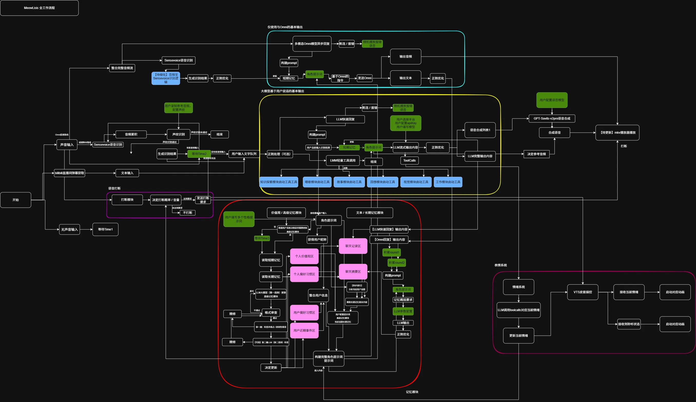
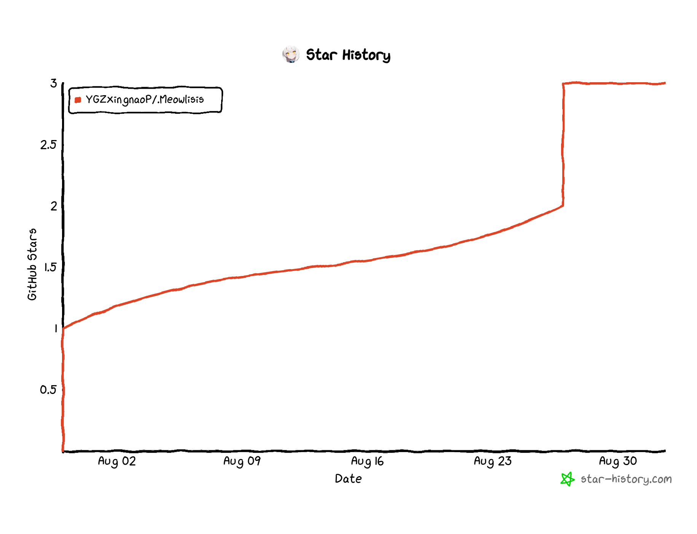

# Meowlisis!

[](说明书.md) [](说明书.en.md)

[](LICENSE)

> 本项目采用 [MIT 许可证](LICENSE) 开源。

```
写代码的初衷是希望自己做动画的时候有个人陪我聊天
然后找不到人，就把一只小猫变成人了awa
更新频率随缘，可以在B站@YGZ醒脑片的直播间不定期看到
```

## 写在最前面
- 这里是Github的源代码区。
- 整合包地址：【百度网盘】链接: https://pan.baidu.com/s/1Ea-LSXFDMSUIN0o-9n4OBQ?pwd=0204 提取码: 0204 
--来自百度网盘超级会员v2的分享
- 超级感谢一下项目的开源，进行了些许参考：
- 整体框架逻辑给我了些许启发：[@worm128/AI-YinMei](https://github.com/worm128/AI-YinMei)
- TTS的音色优化：[@High-Logic/Genie-TTS](https://github.com/High-Logic/Genie-TTS)
- 最喜欢的猫娘项目，在记忆模块方面让我学到了很多：[@Project-N-E-K-O/N.E.K.O](https://github.com/Project-N-E-K-O/N.E.K.O)
- 针对TTS的合成加速，从这个项目第一次了解到GPU Graph的加速方法：[@chinokikiss/GSV-TTS-Lite](https://github.com/chinokikiss/GSV-TTS-Lite)
- WDA：完成了苹果手机的 XCTest 连接使用，伟大无需多言：[@appium/WebDriverAgent](https://github.com/appium/WebDriverAgent)

## 一些原创算法
```也可能不是原创，反正是自己瞎想瞎做的，有兴趣的可以看一下```
### 一、LLM水词的优化

```
对应模块：
func/llm/narration/
```

思路：LLM 回复"水"（全是套话废话）时自动压缩，回复内容丰富时完整保留语气词，让语音合成听起来不啰嗦、不干瘪。核心是「打分 → 分档 → 流式清洗」三层结构：

1. **水词库 → Trie 前缀树**：`adjunct_word.json` 可删除词（参与打分+删除）、`score_only_word.json` 只打分词（人设语气），构建 Trie，最长匹配优先，O(词长)。
2. **EWMA 平滑打分**（每轮用清洗前源文本）：
   - `Raw = max(0, density − penalty)`
   - `density = 100 − (W/L)×100`，当 `W/L ≥ density_threshold` 时 `density = 0`（W=水词总长度，L=文本长度）
   - `penalty = min(length_penalty_cap, max(0, L − length_threshold) × length_penalty_rate)`
   - `S = λ·S_prev + (1−λ)·Raw`，`λ = λ_down (Raw<S) / λ_up (Raw>S) / λ_equal (Raw=S)`
3. **三档流式清洗**（由 S 定档）：
   - `S ≥ part_level_upper` → 不删（FULL）
   - `part_level_lower ≤ S < part_level_upper` → 仅删类别 ∈ {2,3,5}（PART）
   - `S < part_level_lower` → 删全部可删词（ALL）
   - 逐字符 `feed`：Trie 最长匹配，可删词按档位丢弃，命中前缀则暂存；`flush()` 收尾。
4. **标点整理**：清洗后合并连续标点为句号、去掉句首残留标点、纯标点句不发送；再按标点切分为小句流式送入 TTS，保证断句自然。

相关配置：`config.yml → llm.narration`。

### 二、哼唱歌曲接龙触发

```
对应模块：
func/toolbox/meowsongs/hum_detect/hum_detect.py
func/toolbox/meowsongs/pass_the_baton
func/pipeline/toolbox_audio.py
```

思路：用户在角色唱歌时跟着哼一段，角色识别出是哪首歌、哼到哪了，然后**接着往下唱几句**（传花接龙），并播报感想、写入记忆。

1. **哼唱检测**：逐帧 RMS 能量，`rms ≥ vad_energy_threshold`（SenseVoice 配置）视为有声并累积，静音 `≥ silence_threshold` 判定段结束；累积 `≥ hum_collect_sec(7s)` 立即判定。pyin 提 F0（65–800Hz）→ MIDI 音高，只统计有声帧，判据：
   - 有声帧占比：`|voiced|/|f0| ≥ f0_voiced_ratio`
   - 稳定帧占比：`mean(|Δmidi| < f0_stable_half_step) ≥ f0_stable_ratio`
   - 唯一音符数：`len(unique(round(midi))) ≥ f0_unique_notes`
2. **7 秒定歌（lock）**：yin 提 F0（80–800Hz）得哼唱音高序列，与每首歌 vocal 音高缓存（npy）均去均值 `midi' = midi − mean(midi)`，向量化滑窗余弦 `score = max_i dot(w_i,q)/(‖w_i‖·‖q‖)`；`score ≥ match_threshold` 且与次优分差 `≥ min_margin` 才锁定 `{title, offset = best_idx×HOP/SR}`。
3. **段结束接唱（sing）**：用整段哼唱重跑一次余弦匹配，对齐位置即 offset。LRC 时间轴定位，`user_lyric` = `[offset, offset+hum_duration]` 内歌词；从 `offset+hum_duration` 后第一句起取 `hum_lines` 句；播放 `vocal[start_sec : end_sec]`（end=下一句起始，无则至结尾）。
4. **记忆与感想**：用户哼的歌词与 AI 接唱的歌词写入短期/长期/用户记忆（type=hum_song）；接唱播完后由 toolbox LLM 按模板生成感想（含歌名与接唱歌词）播报；若没锁定或分差不足，带 `[System]` 前缀直接告知 LLM 候选歌曲与"先别接唱"，由角色用自己的话确认是否在唱。

相关配置：`config.yml → meowsongs.pass_the_baton`。


## 接下来是一些功能介绍
[](工作流程解析/【待完善】meowlisis工作流程.webp)

*⚠️ 核心功能流程图（待完善，点击图片查看大图）*

### 运行环境
```
WindowsOS 10/11
python 3.11.3
依赖库详见requirements
```

### LLM调用
LLM调用分为正常对话和工具调用
正常对话:
 - 支持 DeepSeek / Qwen（阿里云）/ Gemini / MeowLLM 流式后端，默认 deepseek（可开 thinking）
 - 消息先正则清洗（易错词纠正），入队调度，拼短期记忆后流式输出
```
llm主要负责快速回复，基本仅使用flash级别的文本模型，即可胜任
```

工具调用:
 - 父级 toolcalls：`func/toolbox/analysis.py` 注册「触发型工具」，AI 决定参数与是否开始，模块自己负责后续流程
 - QQ 链路另有自己的意图分析 `func/toolbox/napcat/analysis/`，复用 weather/news/add_backlog 等工具 schema，并带 QQ 专属工具
 - set_emotion工具：每次回复强制调用，LLM输出情绪/强度/性格/是否触发价值观思考
 - 性格从角色卡动态读取，LLM按语境自行切换

提示词:
 - system_prompt自动组装：角色卡 + 价值观 + 用户档案 + 日期 + 记忆摘要 + 知识库（心理/导演/手机/海龟汤等条件块按需拼入）
 - 角色卡绑定参考音频，情绪与音色联动
 - 弹幕走独立提示词，支持多用户与朗读前置
```
作者的话：
一个人的性格是复杂的，不是一份提示词能完全概括的，就算全写进一个提示词，普通的llm也无法很好的理解，所以做了这个动态性格提示词。
其次，这个项目没有考虑支持多ai智能体的互动！
但是吧......或许这个功能有很多其它玩法。
```


### 语音识别
基于 SenseVoice 魔改客户端（WebSocket 连本地服务，2pass 流式识别，断线自动重连）
 - 多音频源独立会话：麦克风 / 扬声器回环(loopback) / 注入源（手机语音、外部 PCM），各源独立 VAD、打断、声纹
 - 噪声过滤：VAD 能量阈值，声音太轻不识别，可配置
 - 声纹检测：多声纹记录，相似度阈值匹配说话人，识别结果绑定用户
 - 数字归一化(itn)、热词、易错词替换规则
 - 实时打断：独立打断阈值，检测到说话即打断 TTS
 - 断句合并(merge_delay)，流式上屏/合成
 - 扬声器回环已实现（WASAPI，需 pyaudiowpatch），默认关闭，可在 audio.sources.loopback 开
 - 手机/外部音频通过 HTTP `/audio/send` 注入 inject 源（不走 WebSocket）；WebSocket 音频传输尚未做

### 语音合成
基于 GPT-SoVITS(v2Pro) 精简版，已内置，HTTP 调用本地服务
 - 流式合成：按静音点智能切分（听感连贯）或定长切分（响应快），块间重叠衔接
 - 情绪驱动：LLM 决策情绪标签+强度 → 情绪映射参考音频 + 每情绪独立采样参数（happy 语速快、sad 语速慢等）
 - 整段语言判定：整段英/日覆盖，混合/中文回退中文（默认中文最稳）
 - 实时打断：SenseVoice 检测到说话即打断；支持 pipeline / 按键 / off（pipeline 需 SenseVoice）
 - 任务队列串行合成（合成/播放各一个后台线程）
 - 段间随机停顿：默认每段播完停 0.5~1s，可关、可按来源

### 记忆模块
CatBrain多层记忆（func/catbrain），各层独立LLM后端（deepseek/aliyun/gemini）
 - 短期记忆：public_short_mem.json，按消息类型独立轮数裁剪
 - 长期记忆：按天落盘 character/memory/日期.txt，对话全量存档
 - 记忆摘要：.temp 下的 record.txt 缓存满 50 条消息就触发一次概括，概括完按月写成 meow-YYMM.json；概括失败把原文写回缓存，等下次重试
 - 摘要写入：三步走，先归类，再检索已有记忆，最后判定关系
 - 记忆审查：新建的候选逐条过审，默认不合格；过审的必须给出归类与置信度，没过审的直接丢掉
 - 证据分：每条记忆带一份信用分，加强和削弱都按半衰期衰减，分太低的挪进归档
 - 摘要检索：按总分排序取前 30 条进提示词，负分和不相关的都不带
 - 记忆精简：cleanup_mem.py 需要时自己执行，默认只看不写，加 --apply 才写入，写入前先备份
 - 当前话题：LLM定期决策（60s缓存），参与摘要排序
 - 用户记忆：新用户LLM猜测建档，老用户每50轮分析更新（AI可判定无变化不改）
 - 价值观：独立LLM维护（高思考强度），12小时定时更新 + 哲思/对话触发，可选二次审查
 - 消息存档：全员记录 + 向量库（embedding+关键词检索）+ 站点检索

<details>
<summary>📁 .temp/public_short_mem.json · 短期记忆</summary>

```json
[
  { "role": "user", "content": "今天天气真好", "type": "llm_fast_response" },
  { "role": "assistant", "content": "是呀，喵~", "type": "llm_fast_response" }
]
```

按 type 独立轮数裁剪
</details>

<details>
<summary>📁 character/memory/2025-06-01.txt · 长期记忆</summary>

```json
[
  "[2025-06-01 12:00:00][000001]: 内容",
  "[2025-06-01 12:00:03][喵利呜西斯]: 是呀，喵~"
]
```

每行一条，按天分文件；用户侧写编号，AI 侧写角色名
</details>

<details>
<summary>📁 character/abstract_memory/meow-2506.json · 记忆摘要</summary>

```json
[
  {
    "event": "用户说喜欢夏天",
    "tags": ["夏天", "爱好"],
    "topics": ["爱好"],
    "joint": [{ "id": "000001", "nickname": "YGZ醒脑片" }],
    "importance": 7,
    "accuracy": 5,
    "time": "2025-06-01-12-00",
    "id": "mem_eff240beba57",
    "evidence": { "reinforcement": 0.5, "disputation": 0.0 }
  }
]
```

按月分文件，参与人按编号+昵称成对记录，证据分带半衰期衰减
</details>

<details>
<summary>📁 character/userinfo/000001/profile.json · 用户档案</summary>

```json
{
  "nickname": "YGZ醒脑片",
  "gender": "unknown",
  "character": "性格描述",
  "likes": "喜好",
  "preference": "偏好",
  "relation": "关系",
  "birthday": "生日",
  "favorite_songs": "爱听的歌",
  "favorite_shows": "爱看的番",
  "favorite_foods": "爱吃的",
  "tags_preference": ["爱好标签"],
  "affinity": 10,
  "recent_events": "最近发生的事"
}
```

按编号分目录，新用户猜测建档，老用户每50轮更新
</details>

<details>
<summary>📁 character/info/values/latest.json · 价值观</summary>

```json
{
  "0204": "主人的话",
  "trust": "信任",
  "belief": "信仰",
  "responsity": "责任",
  "honor": "尊重",
  "tolerance": "宽容"
}
```

0204 为"主人的话"，禁止修改
</details>


### 主动回复（llm_active）
空闲主动回复核心，支持冷却计时、原创话题与继承话题，让角色在无人互动时主动开口。代码在 func/llm_active，配置面板「角色主动回复」。
 - 计时：`llm_active.cold_time` 空闲到期才触发；用户消息、AI 回复、主动触发结束都会重置计时；唱歌/插件声明占用时暂停
 - 分流：连续触发次数 `n` 未超过 `strategy_threshold` 时走 inherit（继承上一场话题），超过后走 origin（原创话题池：5 个话题 + tags + B站缓存视频）
 - 素材：origin 的 web_browse 视频池（自动抓取 → LLM 过滤 → 抽帧 → 视觉概括 → 落盘）；导演规划也复用这个池
 - 导演优先：`AutoActiveCore._trigger` 先问 `DirectorCore.on_idle_trigger`；导演接管成功就不走 inherit/origin，失败自动回落
 - 可调：`llm_active.*`（cold_time、strategy_threshold、web_browse、director 等）
 - 与 QQ 的区别：QQ 没有空闲计时，主动插话是消息驱动（@ / 关键词 / 冒泡），见下面的 QQ 导演

### 导演模块（llm_active.director）
主动回复时的表演规划与执行，代码在 func/llm_active/director；QQ 不接这套，另有简化版（见下）。
 - 触发：每轮主链路回复后异步判官（纯 LLM）判断「主人无聊 / 话题断了」→ 跳过 cold_time 主动开口；空闲到期时由规划器决定是否开始
 - 规划：director_plan 输出 steps（goal / move / expect / if_not），可查 character/memory、复用 B 站视频素材
 - 执行：激活期间用户回合由 func/pipeline/msg_director.py 接管，复用主链路回复逻辑，每回合只走一步
 - 推进：director_step 打标完成 / 调整 / 推进 / clear；漏标累计 `stall_turns` 补判；全部完成或用户明确拒绝即收尾
 - 循环：整段空闲无用户消息记一次失望，连续 `silent_rounds` 次重写计划
 - 落盘：`.temp/director_topic/main.json`；clear 归档 `character/director_topic/main/`
 - 提示词：`director_block.py` 把计划渲染成「当前对话走向」块，插进 system_prompt
 - 可调：llm_active.director.*

导演计划渲染进提示词的示例：
```markdown
# 当前对话走向（必须照做）
由头：一个 UP 主用旧手机跑本地模型，风扇起飞
已经完成：
  [x] 1 起话头
当前这一步（只说这个）：
  [>] 2 吐槽旧手机散热
      招法：先笑一下，再补一句自己这边也烫；猜他会：跟着吐槽；他不这样就把话拉回来：问他电脑烫不烫
之后还有：
  [ ] 3 把话题带到「本地模型值不值」
他刚才的反应：
  他回了一句「我这破笔记本也烫」
规矩：
  · 只演 [>] 这一步，一次走一步
  · 不许把这份清单念出来
  · 说完必须调用 director_step 交回进度
```

### QQ 导演（简化版，func/toolbox/napcat/director）
只服务 QQ 的私聊与群聊 @ / 关键词，和主链路导演完全独立：自己的状态文件、判官、提示词块，不 import 主链路导演/心理状态机，也不参与群聊主动插话（冒泡）。
 - 触发：私聊消息、群聊 @ 或关键词命中（含其后的续聊）；冒泡不参与
 - 判断：回复前一次小判官调用（走 QQ 现成的 toolbox 端口）判断「是不是没话题 / 当前走向要不要收」；没走向时先随机抽一条 `character/shared_videos` 分享过的视频当由头，判官看得到它
 - 走向：起戏时给 1~3 步短走向，附在 QQ 提示词末尾的「当前对话走向（QQ·简化版）」块里；由头只是话头，不照着念
 - 推进：@ / 关键词 / 私聊每真的说出去一句就推进一个，走完自动收；判官听到「别烦 / 不想听」或对方接上话题也会收
 - 隔离：`qq_private:{user_id}` 与 `qq_group:{group_id}` 各存各的，私聊不会串到群、群也不会串到私聊
 - 落盘：`.temp/director_topic/qq/{session}.json`（一个私聊用户 / 一个群一个文件）；clear 后归档到 `character/director_topic/qq/{session}/`（旧 `.temp/latest_director_qq.json` 自动迁移）
 - 可调：napcat.director_qq.*（见配置面板「NapCat 群聊」里的「QQ 导演」）

### 心理状态机（MeowPsyche）
角色「现在心里装着什么」。记的是内心，不是事实，事实归记忆摘要。代码在 func 下的 psyche 目录，独立 LLM 后端（deepseek、aliyun、gemini）
 - 触发：后台线程每 5 秒看一眼短期记忆，角色多出一条新回复就总结一次
 - 输入：最近 3 轮对话，加上自己上一次写的心理，只作对照，不照着抄
 - 输出：调 note_inner 工具，交回一个话题和最多四条内容
 - 话题：正在干的那件事，必须带对象。说不出正在干什么就写空，空话题会把整块清掉
 - 内容：只写自己的心理，每条都从「我」出发，写情绪、想要什么、不敢做或不能做什么、接下来打算做什么
 - 注入：写入 .temp 下的 latest_psyche.json，拼进系统提示词的「我心里装着的」这一段，主对话和弹幕都会带上
 - 场景：main 和 QQ 各有一份状态，互不影响
 - 可调：psyche.enabled、psyche.llm_type、psyche.interval_seconds、psyche.short_rounds

每一轮做的四件事：
```text
1 短期记忆里出现新的角色回复，按最后一条发言判断，记忆被裁剪也不影响
2 取最近 3 轮对话加上一次的心理，一起交给 LLM
3 强制调 note_inner，拿回话题和内容
4 写入 .temp 下的 latest_psyche.json，话题为空就清掉整块
```

示例，跑真实记录（做六级听力那一场）出来的原文，注入进提示词之后长这样：
```markdown
# 我心里装着的
跟主人做英语听力（机场超售那题）
我听到 volunteer 还是想笑，主人果然盯上它了
我惦记他会不会又扯回 Minecraft 去
我忍着没把超售的弯弯绕一次全倒给他
我打算等他再问一句，才把补偿那层讲透
```

第一行是话题，就是角色手里正在干的那件事，下面几行是角色自己的心理。说不出正在干什么时，「我心里装着的」这一整段不会出现在提示词里。

心理块只写「我心里装着的」，不写对话走向。


### 用户ID模块（MeowIdentity）
每个用户一个编号，昵称、QQ号、B站uid 都挂在编号上。身份表在 character/userinfo/users.json，代码在 func/catbrain/UserMemory/identity，入口是 func/pipeline/id_signup.py
 - 编号：六位数字，开号即定。昵称允许重复，区分人只看编号；按昵称反查遇到重名直接拒绝
 - 绑定：一个编号可绑多个平台账号（QQ号 / B站uid），两边都绑就并成一个编号，账号换了编号不动
 - 反查：编号、昵称、账号互相都能查，认不出返回空，重名不猜
 - 临时身份：还没绑正式编号的人先给 temp-编号，绑定即转正，换成正式六位编号，账号与昵称一起带过去
 - 离线身份：本机名 / 声纹名只参与解析（local:、voice:），不落绑定
 - 存档：档案 character/userinfo/{编号}/profile.json，待办同目录，记录 .temp/{编号}_record.txt
 - 提示词：提示词和界面里只出现昵称，编号不进提示词


## 然后是类skills功能的介绍
```为什么说是类skills呢，一是up纯业余，对于MCPskill的概念界定不是很清楚，二是每个功能都是和我加小猫和个人需求强绑定的，几乎没有通用性(不过在实现方法上应该有参考价值，大概)```

工具箱底层（toolbox_core / analysis / config / get_prompt / excuse / port）：
 - `toolbox_core.py`：Toolbox 总入口 `TBoxCore`，持有 pipeline 桥接（SenseVoice / TTS / 长期记忆 / LLM）与父级分析器，统一分发输入输出
 - `analysis.py`：父级 toolcalls `TBoxAnalysis`，维护「动作入口」注册表；父级决策是单轮链路（只执行第一个工具调用、结果不回灌），所以只注册一次调用即完成的入口
 - `config.py`：`TBoxConfig` 集中管理 toolbox 节点配置（独立 LLM 后端等）
 - `get_prompt.py`：从 pipeline 的 system_prompt 桥接取完整提示词，供各模块拟词
 - `excuse.py`：通用询问链路 `TBExcuse`，AI 有疑问时以角色口吻语音询问用户、阻塞等待文本补充，供 weather/news/add_backlog 等复用
 - `port/`：toolbox 独立 LLM 端口（DeepSeek / Qwen / Gemini / MeowLLM）
 - `qq_response.py`：QQ 私聊/群聊完整回复链路，详见下面「QQ / NapCat」

## 视觉模块（MeowVision）
仅在线视觉模型（阿里云百炼 qvq / Gemini / MeowLLM 视觉端口），代码在 func/toolbox/meowvision
 - 触发方式：LLM工具决策(use_vision)，或主动观看(watching)周期截图+画面变化检测
 - 截图 / 画面裁剪 / 变化检测：`image_handle` 工具集；画面有变化才理解，窗口消失自动确认；图片统一缓存到 `.temp/vision_cache`，NapCat 收到的图也先落这里
 - 图片描述作为用户消息送入LLM，并写入短期/长期记忆
 - 两种跑法：`process()` 只返回描述+回复，NapCat 复用后自行发 QQ；`run()` 主链路回 TTS
 - watching：截屏频率 20~120s、持续 5 分钟~5 小时、相似度阈值、窗口消失确认秒数都可配；会话落 `.temp/watching_session.json`
 - 可调：meowvision.*（模型/缓存）、watching.*

## Bilibili直播与弹幕（danmaku）
接入 B 站直播弹幕（blivedm 双通道：开放平台 + web SESSDATA），代码在 func/toolbox/danmaku，可在配置界面扫码登录
 - 读取：连接线程跑双通道，消费轮询线程在 TTS 空闲时消费队列；弹幕按模板朗读（随机/固定）、多用户策略可选
 - 回复：单条/合并回复；SC 走 LLM；礼物/舰长感谢不硬编码，交给 toolbox LLM 拟词 + TTS（优先级与 weather/news 同级）
 - 主动发弹幕：`active_sender`，带冷却与发送开关
 - 身份与拦截：uname 缓存；弹幕里的点歌/翻唱会先被 meowsinger 拦截
 - 可调：danmaku.*（房间号 / SESSDATA / 开放平台密钥 / 朗读 / 礼物 / 合并 / 主动发送）

## 音乐（meowsinger / meowsongs）
点歌、翻唱在 func/meowsinger，即兴哼唱与哼唱接龙在 func/toolbox/meowsongs
 - 点歌：前缀「Meowlisis点歌」/ 意图「点歌、放歌、放首歌」→ 网易云 API 搜歌下载 → 报歌名 → 播放 → 结束信号，支持歌词同步字幕；唱歌中收到的新消息进汇总池，结束后统一回复
 - 翻唱：前缀「Meowlisis唱歌」/ 意图「唱首歌、唱歌」→ RVC 三轨分离 + 变声 + 混音，支持指定模型与特征索引（对应 .RVC 服务）；学歌任务串行；成品存 meow_list；远程 RVC 无接口时自动回退；变调/共振峰/音量可调
 - 即兴哼唱：`impromptu_sing` 工具，按歌词匹配翻唱片段（不带伴奏），支持随机/模糊/精确匹配
 - 哼唱接龙：见 README 的「原创算法二」，hum_detect + pass_the_baton
 - 停止/学歌：唱歌中停止词立即掐断；学歌触发词、学歌用户可配
 - 可调：meowsinger.*、meowsongs.*

## QQ / NapCat（napcat）
NapCat 是 OneBot v11 正向 WS 客户端，代码在 func/toolbox/napcat，回复编排在 func/toolbox/qq_response.py，配置节点 napcat
 - 连接：`napcat_core`（connection / event_handler / api_client / buffer）；`ws_url` / `access_token`；`self_nickname` 用于识别自己；调试可把原始事件落盘 `.temp/napcat_raw_events.jsonl`
 - 私聊：`receive_qq` → 身份 → Creeper → 数据库 → 改图判定 → 插件 → 意图分析（天气/新闻/待办/即兴哼唱/海龟汤/画图等）→ 破甲 → 短/长期记忆 → QQ 导演 → 回复（`llm/napcat_llm`）→ 表情/情绪
 - 群聊：`receive_group` → Creeper → @+图 → 协调器（`groupchat/group_coordinator`，默认 2 秒合并）→ directed（@/关键词）/ followup（续聊）/ active（冒泡）
 - @ / 关键词：立即回复；多人/多触发在合并窗口内并成一条；`group_at` 工具可单独 @ 群成员；关键词命中与 @ 同待遇；QQ 导演在 @/关键词/续聊时接入（见上）
 - 续聊：followup 判断器决定接不接；连续 pass 上限、最大回复轮数、忽略群机器人可配
 - 冒泡：按消息数阈值 + 抖动 + pass 次数决定插话；幻梦等群机器人可被 `ask_group_bot` 调用；冒泡不接导演
 - 群记录/群性质：`get_group_record` / `group_info` 定期概括；群名、群成员档案、群机器人配置都在这里
 - 图片/表情：`image`（image_search / gif_frame / vision_decide）、`message`（emote_choose / emote_sender / clean_emote / quote_store / time_split）
 - 主动发送：`active_sender`（好友/群/群成员列表、发文本/文件/链接），带冷却
 - 诊断/登录态观测：[scripts/napcat_diagnose/README.md](scripts/napcat_diagnose/README.md)
 - 其它：`poke_detector`、`creeper`、`excuse_router`、`emotion_bridge`、`identity/qq_cmd`、`identity/qq_send`、`psyche`、`vision_active`、`director`（QQ 导演）
 - 可调：napcat.*（回复字数/标点/引用/节奏、图片、表情、关键词、合并、续聊、冒泡、群信息、群机器人、导演）

## 天气（weather）
工具 `weather`，代码在 func/toolbox/weather
 - 流程：城市代码查询 → `calendar_new` 获取预报 →（缺城市）excuse 追问 → LLM 拟播报 → TTS 播放（source=toolbox_weather）
 - QQ 场景：`TBWeatherNapcatPlugin` 负责以角色口吻发 QQ 询问、等用户回复、判断是否另起话题；结果由 napcat 模块发 QQ，不走 pipeline TTS
 - 可调：weather.*

## 新闻（news）
工具 `news`，代码在 func/toolbox/news
 - 流程：爬取 readhub 热榜标题 → 进详情页取正文（主标题+相关报道）→ LLM 概括 `top_n` 条 → TTS 播放（source=toolbox_news）
 - QQ 场景：`TBNewsNapcatPlugin` 负责 excuse 追问条数、结果发 QQ
 - 可调：news.*

## 待办与提醒（add_backlog / calendar）
 - 新建：`add_backlog` 工具，父级浅触发后内部二次深度解析（`parse_backlog`：content/time/need_excuse），缺字段用 excuse 追问一轮，最后追加写入 `character/backlog/{编号}/backlog.json`
 - 默认值：day=none、type=instant、loop=3、repeat_interval=300、qq=true；QQ 场景走 `TBNapcatExcuseRouter` 发 QQ 追问，全程不写记忆、不播报
 - 提醒：`func/calendar/backlog.py` 独立线程轮询 `character/backlog`，按计划时刻主动提醒；状态落 `.temp/calendar_backlog_state.json`；插件可通过 `CAP_REMINDER` 暂停；支持直播端与 QQ 双通道

## 节日祝福（calendar）
代码在 func/calendar
 - 节日数据：`holiday.json`，支持公历固定节日、农历节日、24 节气、浮动节日（母亲节/父亲节等）
 - 祝福文案：`greeting.json` 按生日/节日/节气配置模板，缺省用兜底模板；优先级生日 > 节日 > 节气
 - 触发：用户当天第一次说话才占用祝福；`mark_first=False` 时只保留日期信息、不判祝福；生日按用户档案
 - 日期块：节日/节气/生日汇总进提示词；prompt_builder 负责拼接与首次判定

## 绘画与改图（flux_painter）
工具 `flux_paint`，代码在 func/toolbox/flux_painter
 - 生成：ComfyUI 文生图（UNET 底模、1024x1024 / 1080x1960 两档画布）；LLM 产出标题、positive tag、cinema 自然语言、汇报语、画布规格，并带角色知识
 - 审查与存档：NSFW 审查、画作归档；画完播报 review 语音
 - 画板服务：HTTP 8090 托管 painting_board.html + 图片/审查接口，WS 8767 按 channel 推送
 - 改图：画完 window 内、下一条完整 @/关键词消息由 `edit_router` LLM 判定是否在上一张图上改，是则续画
 - 场景：live / QQ 都能用；绘画中冷却，不长期接管
 - 可调：flux_painter.*

## 海龟汤（turtle_soup）
工具 `turtle_soup`，代码在 func/toolbox/turtle_soup
 - 题库：`character/turtle_soup`；缓存 `.temp/turtle_soup`；汤面按 easy/hard 长度控制
 - 流程：`generate` 出题 → `prompt` 拼游戏块 → 用户提问 → `judge` 判 solved / give_up / repeat → 揭开汤底
 - 会话隔离：live / qq_private / qq_group 各一份运行态
 - 可调：turtle_soup.*（enabled、qq_enabled、题库/缓存目录、汤面长度等）

## 讲故事
施工中，暂无实现。

## 文件读取（txt_reader）
文本读取模块（func/catbrain/txt_reader），支持文件列表、切分、关键词定位与分词；读到的文本可交给 LLM 做长文阅读、定位与问答。

## 知识库（database）
数据库/RAG 知识库，支持爬取指定站点、向量检索与关键词匹配，可将内容学习入库。
 - 入库：抓取正文 → 分块 → 向量化 → 写入向量库；原始文件归档
 - 检索：向量相似度 + 关键词双路，命中片段拼进提示词

## 网页浏览（web_browse）
主动浏览 B 站内容，自动截帧、筛选话题并生成摘要，支持缓存与收藏；也是 origin/导演的视频素材池。
 - 流程：候选视频 → LLM 过滤（话题/标签/红线）→ 抽帧 → 视觉概括 → 落缓存；被采用后移到 `character/shared_videos`
 - 可调：llm_active.web_browse.*（开关、间隔、缓存上限、允许话题等）

## 记忆整理（catbrain）
抽象记忆、用户记忆与长期记忆等多层记忆协同，定时摘要与整理，持续优化中。
 - 摘要：record 缓存满额触发概括，按月归档；失败回写原文等下次重试
 - 用户档案：新用户猜测建档，老用户按轮数增量更新；价值观独立线程维护
 - 精简：cleanup_mem 默认只看不写，加 --apply 才执行，写入前备份
 - 召回实验：[scripts/memory_recall_lab/README.md](scripts/memory_recall_lab/README.md)

## 手机操控
让角色自己拿着手机办事：电脑通过 USB 隧道把 WebDriverAgent 跑在 iPhone 上（魔改版见 [CatApps_iOS](https://github.com/YGxingnaoP/CatApps_iOS)），角色看图、点击、输入、翻页，边做边说话。对应 `func/catpaws`（只做意图判断与语音/记忆桥接，不碰 LLM）与 `.vendor/.CatPaws`（独立 LLM、操作链路、action 脚本、屏幕推流），配置真值在 `.vendor/.CatPaws/config.yml`。

- 触发：说「喵呜我要点外卖」直接接链路；只提「手机」等意图词则先让 LLM 判断要不要接管
- 操作分三类：单次（点一下、滑一下、返回）、连续（一次下发多步，默认 90ms 间隔）、action 脚本（流程固定就沉淀成 `actions/<id>/`，反思阶段写完要主人点两次头）
- 收尾：办完先问「还有别的事吗」，确认后进反思沉淀脚本；付款、密码、隐私类操作整条链路都禁止
- 说话与记忆：手机端的回复走角色声线播报，同时写进短期记忆（`phone_control_user` / `phone_control_response`）、长期记忆与用户记忆
- GUI：手机操作面板里有实时画面、操作流水、配置面板与启动按钮；手机端用浏览器打开 `https://<电脑IP>:8443` 能看到桌宠
- 单独联调：`scripts\catpaws\catpaws_device_test.bat` 开「对话 + 流水」两个窗口，可直接跑真机，不用启动主程序
- 详细说明：CatPaws 服务 [.vendor/.CatPaws/README.md](.vendor/.CatPaws/README.md)；启动器 [.vendor/.CatPaws/catpaws-launcher/README.md](.vendor/.CatPaws/catpaws-launcher/README.md)；联调脚本 [scripts/catpaws/README.md](scripts/catpaws/README.md)；手机界面 [.vendor/.cam/README.md](.vendor/.cam/README.md)

## Vtuber皮套
通过 VTube Studio 的 WebSocket 接口驱动 Live2D 皮套，支持情绪→表情映射、身体摆动与口型同步，对应 func/vts 模块。
 - 情绪：LLM 决策的情绪/强度映射到表情与动作
 - 口型：TTS 播放时按音频驱动口型；说话/动作可叠加
 - 连接：VTube Studio 插件鉴权 + WebSocket 常驻

## 插件系统（plugins）
插件目录、plugin.py / schema.py / config.yml、main / qq 通道、加载与禁用规则见 [plugins/plugins.md](plugins/plugins.md)。

## Minecraft日志读取（minecraft）
代码在 func/toolbox/minecraft
 - `logreader`：轮询日志文件、自动编码检测、正则提取聊天/事件、去重后送入 LLM；间隔、路径、编码、玩家白名单可配
 - 游戏内适配施工中。
```
完全没有做玩MC的适配，等世界模型吧，现在模型玩游戏真不能看
```

## To do list
1、给不同的提示词配置对应的参考音频
2、补全施工内容

## Requirements
依赖清单见 requirements.txt，运行环境为 Python 3.11（项目内置 runtime 目录）。

## Star History

<p align="center">
  <a href="https://www.star-history.com/#YGZxingnaoP/.Meowlisis&Date">
    
  </a>
</p>
